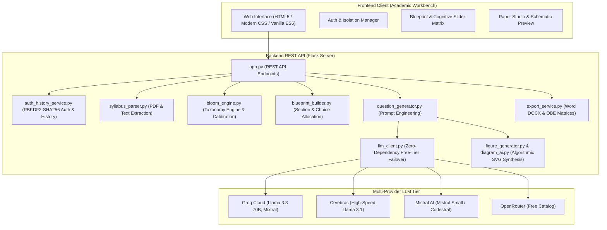

# BloomCraft AI &mdash; Cognitive Examination Engineering System

<p align="center">
  
  
  
  
  
  
</p>

---

> **University-grade automated examination engineering studio adhering to Revised Bloom's Taxonomy, automated syllabus ingestion, cognitive blueprinting, outcome-based education (OBE) standards, and AICTE examination reform policies.**

---

> [!IMPORTANT]
> ### 🛡️ Commercial Use & Resale Restriction Notice
> Copyright &copy; 2026 **Pranav Suryawanshi** ([@PranavSuryawanshi11](https://github.com/PranavSuryawanshi11)). All rights reserved.
> 
> This software is distributed under a **Strict Non-Commercial Source-Available License**.
> - **Free for Personal, Academic & Educational Use**: Faculty, researchers, and students may inspect, test, and run this system for learning and non-commercial research.
> - **Commercial Sale Strictly Prohibited**: **No individual, business, or organization may sell, resell, lease, sublicense, monetize, or offer this software as a paid SaaS/cloud service without explicit prior written consent from Pranav Suryawanshi.**
> - For enterprise licensing, institutional deployment permissions, or commercial authorization, contact: [`pranavsuryawanshi955@gmail.com`](mailto:pranavsuryawanshi955@gmail.com).

---

## 📑 Table of Contents

- [Overview](#-overview)
- [System Architecture](#-system-architecture)
- [Key Features](#-key-features)
- [Cognitive Tiers (Bloom's Taxonomy)](#-cognitive-tiers-blooms-taxonomy)
- [Project Directory Structure](#-project-directory-structure)
- [Quick Start & Installation](#-quick-start--installation)
- [Environment Configuration](#-environment-configuration)
- [REST API Specifications](#-rest-api-specifications)
- [Automated Test Suite](#-automated-test-suite)
- [Security & Confidentiality](#-security--confidentiality)
- [Contributing & Code of Conduct](#-contributing--code-of-conduct)
- [License](#-license)

---

## 🌟 Overview

**BloomCraft AI** is an intelligent, full-stack examination engineering workbench designed for university faculty and academic institutions. It transforms unstructured course syllabi into balanced, high-fidelity examination papers calibrated across cognitive learning tiers (L1 Remember through L6 Create), mapped directly to Course Outcomes (COs), and rendered with technical schematic diagrams and official institutional export formats.

---

## 🏗️ System Architecture



---

## 🚀 Key Features

1. **Revised Bloom's Taxonomy Calibration**: Automatically constructs cognitive distributions ensuring balanced assessment across all 6 tiers:
   - **L1** Remember &bull; **L2** Understand &bull; **L3** Apply
   - **L4** Analyze &bull; **L5** Evaluate &bull; **L6** Create
2. **Automated Syllabus & PDF Ingestion**: Extracts text, modules, chapters, and course objectives from course syllabi using `pdfplumber`.
3. **Outcome-Based Blueprint Builder**: Customizes marks, sections, internal choices, and Course Outcome (CO1–CO6) distributions with real-time cognitive index calibration.
4. **Multi-Provider Free-Tier LLM Architecture**: Built-in resilient dynamic failover and discovery across free-tier providers:
   - **Groq Cloud** (Llama 3.3, Mixtral)
   - **OpenRouter** (Free-tier catalog)
   - **Cerebras Cloud** (Ultra-fast Llama models)
   - **Mistral AI** (Mistral Small / Codestral)
5. **Technical Figure & Schematic Generator**: Synthesizes algorithmic SVG circuit diagrams, network topologies, architecture diagrams, and scientific schematics with zero external graphic dependencies.
6. **University Examination Export**: Generates production-ready Microsoft Word (`.docx`) documents with institutional headers, course outcome mapping matrices, and clean CSS print formatting.
7. **Faculty Authentication & Isolated Archive**: Secure faculty login and sign-up with PBKDF2 password hashing and private, per-teacher examination question paper history.

---

## 📊 Cognitive Tiers (Bloom's Taxonomy)

| Level | Cognitive Tier | Primary Verbs / Stems | Assessment Objective |
| :---: | :--- | :--- | :--- |
| **L1** | **Remember** | *Define, List, State, Recall, Identify* | Retrieval of foundational definitions, facts, and core concepts |
| **L2** | **Understand**| *Explain, Describe, Illustrate, Summarize* | Comprehension and interpretation of principles and workflows |
| **L3** | **Apply** | *Calculate, Implement, Solve, Execute* | Applying theoretical techniques to solve concrete engineering problems |
| **L4** | **Analyze** | *Differentiate, Compare, Deconstruct* | Breaking down complex systems and diagnosing structural components |
| **L5** | **Evaluate** | *Assess, Justify, Appraise, Validate* | Critical evaluation, trade-off analysis, and standard benchmarking |
| **L6** | **Create** | *Design, Synthesize, Formulate, Construct* | Designing novel architectures, models, schematics, and algorithms |

---

## 📁 Project Directory Structure

```text
├── .github/
│   ├── ISSUE_TEMPLATE/
│   │   ├── bug_report.md              # Standardized bug reporting template
│   │   └── feature_request.md         # Feature enhancement proposal template
│   └── pull_request_template.md       # PR checklist and submission guidelines
│
├── backend/
│   ├── app.py                         # Flask REST API server and static web host
│   ├── config.py                      # Cognitive presets, Bloom levels, and university templates
│   ├── .env.example                   # Backend environment configuration template
│   ├── core/
│   │   ├── auth_history_service.py    # Faculty authentication, PBKDF2 hashing & history archive
│   │   ├── bloom_engine.py            # Bloom distribution validators and cognitive index calculations
│   │   ├── blueprint_builder.py       # Examination blueprint compiler and section allocation
│   │   ├── diagram_ai.py              # AI-assisted SVG technical diagram synthesis
│   │   ├── export_service.py          # Word DOCX generation with AICTE matrix tables
│   │   ├── figure_generator.py        # Algorithmic SVG diagram rendering engine
│   │   ├── figure_planner.py          # Prompt analysis and diagram candidate identification
│   │   ├── llm_client.py              # Zero-dependency multi-provider LLM client with runtime failover
│   │   ├── question_generator.py      # Prompt builder and question synthesizer
│   │   └── syllabus_parser.py         # PDF syllabus extractor and module segmenter
│   ├── data/
│   │   ├── bloom_stems.json           # Action verbs and stems for each Bloom cognitive level
│   │   ├── custom_templates.json      # User-defined examination templates
│   │   ├── sample_syllabi.json        # Preloaded reference syllabi for quick demonstration
│   │   └── user_question_sets.json    # Question bank sets
│   ├── test_auth_history_integration.py # Auth and history service integration tests
│   ├── test_e2e_live.py               # End-to-end question paper workflow tests
│   └── test_generator.py              # Cognitive paper generation unit tests
│
├── frontend/
│   ├── index.html                     # Single-page application interface and auth portal
│   ├── css/
│   │   ├── components.css             # Component library (badges, modals, form controls, cards)
│   │   ├── main.css                   # Core design system, typography, and color variables
│   │   └── print.css                  # Print-specific styling for clean question paper export
│   └── js/
│       ├── app.js                     # Global state, workflow controller, notifications
│       ├── auth.js                    # Faculty login/signup session controller and history modal
│       ├── blueprint.js               # Blueprint matrix editor and cognitive sliders
│       ├── custom_sets.js             # Custom question sets manager
│       ├── export.js                  # Document export and client-side formatting
│       ├── generator.js               # Question generation and regeneration controller
│       └── syllabus.js                # Syllabus upload and text ingestion handler
│
├── .env.example                       # Root environment variables template
├── .gitignore                         # Comprehensive Git exclusion rules
├── CODE_OF_CONDUCT.md                 # Contributor Covenant Code of Conduct
├── CONTRIBUTING.md                    # Developer and contribution guidelines
├── LICENSE                            # Strict Non-Commercial Source-Available License
├── package_project.py                 # Clean distribution zip packaging utility
├── requirements.txt                   # Production Python dependencies
├── SECURITY.md                        # Responsible vulnerability disclosure policy
└── README.md                          # Project documentation
```

---

## 🛠️ Quick Start & Installation

### 1. Prerequisites
- Python **3.9+** (3.10, 3.11, or 3.12 recommended)
- Git

### 2. Clone the Repository
```bash
git clone https://github.com/PranavSuryawanshi11/Blooms-Taxonomy.git
cd Blooms-Taxonomy
```

### 3. Create and Activate a Virtual Environment
- **Windows (Command Prompt / PowerShell):**
  ```powershell
  python -m venv venv
  .\venv\Scripts\activate
  ```
- **macOS / Linux:**
  ```bash
  python3 -m venv venv
  source venv/bin/activate
  ```

### 4. Install Dependencies
```bash
pip install -r requirements.txt
```

### 5. Configure Environment Variables
Copy the template `.env.example` to `.env`:
```bash
# Windows PowerShell:
Copy-Item .env.example .env

# macOS / Linux / Bash:
cp .env.example .env
```

Open `.env` and fill in at least one free-tier API key:
```ini
# Groq (Recommended - Free Tier, Fast): https://console.groq.com/keys
GROQ_API_KEY=your_groq_api_key_here

# OpenRouter (Optional): https://openrouter.ai/keys
OPENROUTER_API_KEY=

# Cerebras (Optional): https://cloud.cerebras.ai
CEREBRAS_API_KEY=

# Mistral (Optional): https://console.mistral.ai
MISTRAL_API_KEY=
```

> **Security Note:** The `.env` file contains secret credentials and is strictly ignored in `.gitignore`. **Never commit or push `.env` to any Git repository.**

### 6. Run the Application
```bash
python backend/app.py
```
Open your browser and navigate to:
```text
http://127.0.0.1:5000
```

---

## 🔌 REST API Specifications

| Method | Endpoint | Description |
| :--- | :--- | :--- |
| `POST` | `/api/auth/register` | Register new faculty profile with encrypted credentials |
| `POST` | `/api/auth/login` | Authenticate faculty member and issue session token |
| `GET`  | `/api/auth/me` | Fetch authenticated faculty profile information |
| `POST` | `/api/upload-syllabus` | Parse and ingest syllabus from PDF or raw plain text |
| `POST` | `/api/build-blueprint` | Compile balanced examination blueprint with CO allocations |
| `POST` | `/api/generate-paper` | Synthesize complete examination paper with Bloom calibration |
| `POST` | `/api/generate-figure` | Algorithmic technical diagram generation (SVG) |
| `POST` | `/api/export-docx` | Export paper to styled Microsoft Word (`.docx`) with AICTE matrix |
| `GET`  | `/api/history` | Retrieve private archived examination papers for logged-in faculty |

---

## 🧪 Automated Test Suite

To verify backend modules, cognitive calibration, and user authentication isolation:
```bash
# Test Faculty Authentication and Isolated Paper History
python backend/test_auth_history_integration.py

# Test Question Generation & Bloom Distribution Validation
python backend/test_generator.py

# Test End-to-End Live Workflow (requires valid API key in .env)
python backend/test_e2e_live.py
```

---

## 🔒 Security & Confidentiality

- **Zero-Credential Commits**: Secret `.env` files are ignored across all folders by `.gitignore`.
- **Faculty Data Isolation**: Faculty accounts and generated history are stored locally in `backend/data/user_store.json` (strictly ignored from version control).
- **PBKDF2 Password Hashing**: Passwords are saved with cryptographically secure salted hashes (`PBKDF2-SHA256` with 120,000 iterations).
- **Responsible Disclosure**: See [SECURITY.md](SECURITY.md) for vulnerability reporting.

---

## 🤝 Contributing & Code of Conduct

We welcome community feedback, issue reports, and non-commercial open-source enhancements.
- Please review our [CONTRIBUTING.md](CONTRIBUTING.md) before submitting Pull Requests.
- Participants are expected to adhere to the [CODE_OF_CONDUCT.md](CODE_OF_CONDUCT.md).

---

## 📄 License & Commercial Rights

Copyright &copy; 2026 **Pranav Suryawanshi** ([@PranavSuryawanshi11](https://github.com/PranavSuryawanshi11)). All rights reserved.

This project is released under the **BloomCraft AI Non-Commercial Source-Available License**:
- **Free for Non-Commercial Use**: You are free to view, study, test, and run this software for personal, academic, and non-commercial institutional research.
- **Strict Commercial Prohibition**: **No individual, business, or entity may sell, resell, lease, sublicense, monetize, or offer this software or derivative works as a paid commercial product or SaaS service without prior explicit written consent from Pranav Suryawanshi.**

For complete legal terms, review the [LICENSE](LICENSE) file. For commercial licensing inquiries or enterprise permissions, contact:
**[`pranavsuryawanshi955@gmail.com`](mailto:pranavsuryawanshi955@gmail.com)**.
