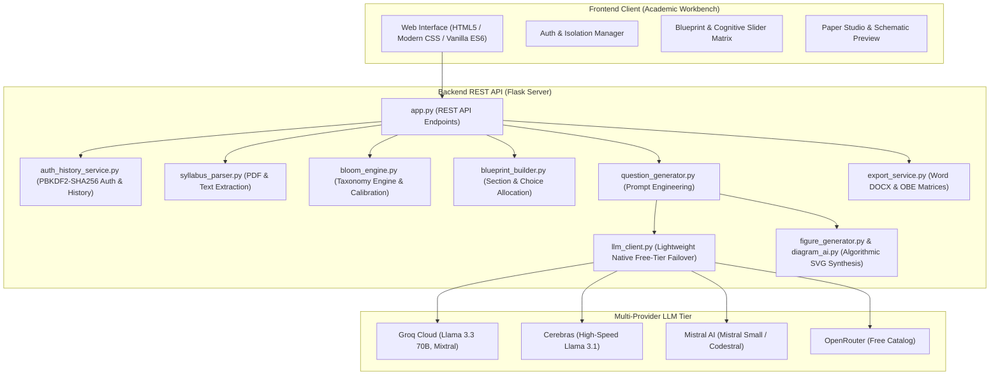

# BloomCraft AI &mdash; Cognitive Examination Engineering System

<p align="center">
  <a href="https://github.com/PranavSuryawanshi11/Blooms-Taxonomy/actions/workflows/ci.yml" target="_blank">
    
  </a>
  <a href="https://blooms-taxonomy.onrender.com/" target="_blank">
    
  </a>
  <a href="https://www.python.org/" target="_blank">
    
  </a>
  <a href="https://flask.palletsprojects.com/" target="_blank">
    
  </a>
  <a href="#license-commercial-rights">
    
  </a>
  <a href="#cognitive-tiers-blooms-taxonomy">
    
  </a>
  <a href="#key-features">
    
  </a>
  <a href="#environment-configuration">
    
  </a>
</p>

---

> **University-grade automated examination engineering studio adhering to Revised Bloom's Taxonomy, automated syllabus ingestion, cognitive blueprinting, outcome-based education (OBE) standards, and AICTE examination reform policies.**
>
> 🚀 **Live Production Deployment**: [https://blooms-taxonomy.onrender.com/](https://blooms-taxonomy.onrender.com/)

---

> [!IMPORTANT]
> ### 🛡️ Commercial Use & Resale Restriction Notice
> Copyright &copy; 2026 **Pranav Suryawanshi** ([@PranavSuryawanshi11](https://github.com/PranavSuryawanshi11)). All rights reserved.
> 
> This software is distributed under a **Strict Non-Commercial Source-Available License**.
> - **Free for Personal, Academic & Educational Use**: Faculty, researchers, and students may inspect, test, and run this system for learning and non-commercial research.
> - **Commercial Sale Strictly Prohibited**: **No individual, business, or organization may sell, resell, lease, sublicense, monetize, or offer this software as a paid SaaS/cloud service without explicit prior written consent from Pranav Suryawanshi.**
> - For enterprise licensing, institutional deployment permissions, or commercial authorization, contact: [`pranavsuryawanshi955@gmail.com`](mailto:pranavsuryawanshi955@gmail.com).

---

## 📑 Table of Contents

- [Live Demo](#live-demo)
- [Overview](#overview)
- [System Architecture](#system-architecture)
- [Key Features](#key-features)
- [Cognitive Tiers (Bloom's Taxonomy)](#cognitive-tiers-blooms-taxonomy)
- [Project Directory Structure](#project-directory-structure)
- [Quick Start & Installation](#quick-start-installation)
- [Environment Configuration](#environment-configuration)
- [REST API Specifications](#rest-api-specifications)
- [Automated Test Suite](#automated-test-suite)
- [Security & Confidentiality](#security-confidentiality)
- [Contributing & Code of Conduct](#contributing-code-of-conduct)
- [License & Commercial Rights](#license-commercial-rights)

---

<a id="live-demo"></a>
## 🌐 Live Demo & Deployment

The system is deployed and available live on Render:

👉 **[https://blooms-taxonomy.onrender.com/](https://blooms-taxonomy.onrender.com/)**

Academic faculty and evaluators can explore the complete examination engineering workflow, upload syllabus documents, configure cognitive blueprint matrices, and synthesize AICTE-compliant question papers directly in the cloud.
> [!NOTE]
> **Ephemeral Storage Notice on Render Free Tier**: The live demo on Render uses an ephemeral disk. Any faculty test accounts or examination history generated during evaluation will reset when the free-tier service restarts or redeploys. For persistent institutional use, configure persistent disk storage or run locally with SQLite.

---

<a id="overview"></a>
## 🌟 Overview

**BloomCraft AI** is an intelligent, full-stack examination engineering workbench designed for university faculty and academic institutions. It transforms unstructured course syllabi into balanced, high-fidelity examination papers calibrated across cognitive learning tiers (L1 Remember through L6 Create), mapped directly to Course Outcomes (COs), and rendered with technical schematic diagrams and official institutional export formats.

---

<a id="system-architecture"></a>
## 🏗️ System Architecture



---

<a id="key-features"></a>
## 🚀 Key Features

1. **Revised Bloom's Taxonomy Calibration**: Automatically constructs cognitive distributions ensuring balanced assessment across all 6 tiers:
   - **L1** Remember &bull; **L2** Understand &bull; **L3** Apply
   - **L4** Analyze &bull; **L5** Evaluate &bull; **L6** Create
2. **Automated Syllabus & PDF Ingestion**: Extracts text, modules, chapters, and course objectives from course syllabi using `pdfplumber`.
3. **Outcome-Based Blueprint Builder**: Customizes marks, sections, internal choices, and Course Outcome (CO1–CO6) distributions with real-time cognitive index calibration.
4. **Multi-Provider Free-Tier LLM Architecture**: Built-in resilient dynamic failover and discovery across free-tier providers:
   - **Groq Cloud** (Llama 3.3, Mixtral)
   - **OpenRouter** (Free-tier catalog)
   - **Cerebras Cloud** (Ultra-fast Llama models)
   - **Mistral AI** (Mistral Small / Codestral)
5. **Technical Figure & Schematic Generator**: Synthesizes algorithmic SVG circuit diagrams, network topologies, architecture diagrams, and scientific schematics with zero external graphic dependencies.
6. **University Examination Export**: Generates production-ready Microsoft Word (`.docx`) documents with institutional headers, course outcome mapping matrices, and clean CSS print formatting.
7. **Faculty Authentication & Isolated Archive**: Secure faculty login and sign-up with PBKDF2 password hashing and private, per-teacher examination question paper history.

---

<a id="cognitive-tiers-blooms-taxonomy"></a>
## 📊 Cognitive Tiers (Bloom's Taxonomy)

| Level | Cognitive Tier | Primary Verbs / Stems | Assessment Objective |
| :---: | :--- | :--- | :--- |
| **L1** | **Remember** | *Define, List, State, Recall, Identify* | Retrieval of foundational definitions, facts, and core concepts |
| **L2** | **Understand**| *Explain, Describe, Illustrate, Summarize* | Comprehension and interpretation of principles and workflows |
| **L3** | **Apply** | *Calculate, Implement, Solve, Execute* | Applying theoretical techniques to solve concrete engineering problems |
| **L4** | **Analyze** | *Differentiate, Compare, Deconstruct* | Breaking down complex systems and diagnosing structural components |
| **L5** | **Evaluate** | *Assess, Justify, Appraise, Validate* | Critical evaluation, trade-off analysis, and standard benchmarking |
| **L6** | **Create** | *Design, Synthesize, Formulate, Construct* | Designing novel architectures, models, schematics, and algorithms |

---

<a id="project-directory-structure"></a>
## 📁 Project Directory Structure

```text
├── .github/
│   ├── workflows/
│   │   └── ci.yml                     # Continuous Integration workflow (Python 3.11)
│   ├── ISSUE_TEMPLATE/
│   │   ├── bug_report.md              # Standardized bug reporting template
│   │   └── feature_request.md         # Feature enhancement proposal template
│   └── pull_request_template.md       # PR checklist and submission guidelines
│
├── backend/
│   ├── app.py                         # Flask REST API server and static web host
│   ├── config.py                      # Cognitive presets, Bloom levels, and university templates
│   ├── .env.example                   # Backend environment configuration template
│   ├── core/
│   │   ├── auth_history_service.py    # Faculty authentication, PBKDF2 hashing & history archive
│   │   ├── bloom_engine.py            # Bloom distribution validators and cognitive index calculations
│   │   ├── blueprint_builder.py       # Examination blueprint compiler and section allocation
│   │   ├── diagram_ai.py              # AI-assisted SVG technical diagram synthesis
│   │   ├── export_service.py          # Word DOCX generation with AICTE matrix tables
│   │   ├── figure_generator.py        # Algorithmic SVG diagram rendering engine
│   │   ├── figure_planner.py          # Prompt analysis and diagram candidate identification
│   │   ├── llm_client.py              # Lightweight multi-provider LLM client with runtime failover
│   │   ├── question_generator.py      # Prompt builder and question synthesizer
│   │   └── syllabus_parser.py         # PDF syllabus extractor and module segmenter
│   ├── data/
│   │   ├── bloom_stems.json           # Action verbs and stems for each Bloom cognitive level
│   │   ├── custom_templates.json      # User-defined examination templates
│   │   ├── sample_syllabi.json        # Preloaded reference syllabi for quick demonstration
│   │   └── user_question_sets.json    # Question bank sets
│   ├── test_auth_history_integration.py # Auth and history service integration tests
│   ├── test_e2e_live.py               # End-to-end question paper workflow tests
│   └── test_generator.py              # Cognitive paper generation unit tests
│
├── tests/                             # Automated test suite (Smoke, Unit, Mocked LLM)
│   ├── conftest.py                    # Pytest test fixtures and Flask app harness
│   ├── test_smoke.py                  # API endpoints and route availability tests
│   ├── test_generation.py             # Deterministic blueprint & mocked LLM tests
│   └── test_e2e_live_skipped.py       # Live E2E test runner (conditional)
│
├── frontend/
│   ├── index.html                     # Single-page application interface and auth portal
│   ├── css/
│   │   ├── components.css             # Component library (badges, modals, form controls, cards)
│   │   ├── main.css                   # Core design system, typography, and color variables
│   │   └── print.css                  # Print-specific styling for clean question paper export
│   └── js/
│       ├── app.js                     # Global state, workflow controller, notifications
│       ├── auth.js                    # Faculty login/signup session controller and history modal
│       ├── blueprint.js               # Blueprint matrix editor and cognitive sliders
│       ├── custom_sets.js             # Custom question sets manager
│       ├── export.js                  # Document export and client-side formatting
│       ├── generator.js               # Question generation and regeneration controller
│       └── syllabus.js                # Syllabus upload and text ingestion handler
│
├── .env.example                       # Root environment variables template
├── .gitignore                         # Comprehensive Git exclusion rules
├── CODE_OF_CONDUCT.md                 # Contributor Covenant Code of Conduct
├── CONTRIBUTING.md                    # Developer and contribution guidelines
├── LICENSE                            # Strict Non-Commercial Source-Available License
├── package_project.py                 # Clean distribution zip packaging utility
├── pytest.ini                         # Pytest test discovery and configuration
├── requirements.txt                   # Production Python dependencies
├── requirements-dev.txt               # Development, testing, and linting dependencies
├── CHANGELOG.md                       # Release notes and version history
├── SECURITY.md                        # Responsible vulnerability disclosure policy
└── README.md                          # Project documentation
```

---

<a id="quick-start-installation"></a>
## 🛠️ Quick Start & Installation

### Step 1: Check Prerequisites
- Python **3.9+** installed (`python --version`)
- Git installed (`git --version`)

### Step 2: Clone the Repository
```bash
git clone https://github.com/PranavSuryawanshi11/Blooms-Taxonomy.git
cd Blooms-Taxonomy
```

### Step 3: Create & Activate Virtual Environment
- **Windows (Command Prompt / PowerShell):**
  ```powershell
  python -m venv venv
  .\venv\Scripts\activate
  ```
- **macOS / Linux:**
  ```bash
  python3 -m venv venv
  source venv/bin/activate
  ```

### Step 4: Install Dependencies
```bash
pip install -r requirements.txt
```

### Step 5: Start the Backend Server
```bash
python backend/app.py
```

### Step 6: Access the Academic Studio
Open your browser and navigate to:
```text
http://127.0.0.1:5000
```

---

<a id="environment-configuration"></a>
## ⚙️ Environment Configuration

BloomCraft AI supports free-tier LLM providers out of the box with zero required credit cards. Environment variables are managed using `.env` files.

### 1. Initialize Your Environment File

Copy the provided [`.env.example`](.env.example) to `.env`:

- **Windows PowerShell:**
  ```powershell
  Copy-Item .env.example .env
  ```
- **macOS / Linux / Bash:**
  ```bash
  cp .env.example .env
  ```

### 2. Supported Free-Tier Providers Matrix

You only need **at least ONE** free-tier API key configured to generate examination papers:

| Provider | Supported Models | Free Tier Portal | Key Highlights |
| :--- | :--- | :--- | :--- |
| **Groq Cloud** *(Recommended)* | `llama-3.3-70b-versatile`, `mixtral-8x7b-32768` | [console.groq.com/keys](https://console.groq.com/keys) | High speed (~300 tokens/sec), generous free tier limits |
| **OpenRouter** | `:free` catalog (DeepSeek, Llama, Qwen) | [openrouter.ai/keys](https://openrouter.ai/keys) | Access to dozens of open-source models at zero cost |
| **Cerebras Cloud** | `llama3.1-8b`, `llama3.1-70b` | [cloud.cerebras.ai](https://cloud.cerebras.ai) | Ultra-low latency wafer-scale inference engine |
| **Mistral AI** | `mistral-small-latest`, `codestral-latest` | [console.mistral.ai](https://console.mistral.ai) | Free Experiment plan with high academic reasoning |


> [!NOTE]
> **Provider Priority vs. Recommendation**: While **Groq Cloud** is marked as *(Recommended)* due to inference speed and generous free limits, the engine's built-in default fallback priority sequence is `mistral,cerebras,groq,openrouter` if multiple keys are provided. You can customize your preference using `BLOOMCRAFT_LLM_ORDER` in `.env`.

### 3. Environment Variables Reference

Edit `.env` in the project root:

```ini
# =========================================================================
# BloomCraft AI - Environment Configuration
# =========================================================================

# Groq Cloud API Key (Recommended)
GROQ_API_KEY=your_groq_api_key_here

# OpenRouter API Key (Optional)
OPENROUTER_API_KEY=

# Cerebras Cloud API Key (Optional)
CEREBRAS_API_KEY=

# Mistral AI API Key (Optional)
MISTRAL_API_KEY=

# Optional: Preferred Provider Failover Order (default: mistral,cerebras,groq,openrouter)
BLOOMCRAFT_LLM_ORDER=mistral,cerebras,groq,openrouter

# Optional: Server Port & Host Configuration
PORT=5000
FLASK_DEBUG=0
```

> **🛡️ Security Best Practice**: Secret API credentials belong strictly in your local `.env` file, which is excluded from version control via [`.gitignore`](.gitignore). A template is provided in [`.env.example`](.env.example) for reference.

---

<a id="rest-api-specifications"></a>
## 🔌 REST API Specifications

| Method | Endpoint | Description |
| :--- | :--- | :--- |
| `POST` | `/api/auth/register` | Register new faculty profile with encrypted credentials |
| `POST` | `/api/auth/login` | Authenticate faculty member and issue session token |
| `GET`  | `/api/auth/me` | Fetch authenticated faculty profile information |
| `POST` | `/api/upload-syllabus` | Parse and ingest syllabus from PDF or raw plain text |
| `POST` | `/api/build-blueprint` | Compile balanced examination blueprint with CO allocations |
| `POST` | `/api/generate-paper` | Synthesize complete examination paper with Bloom calibration |
| `POST` | `/api/generate-figure` | Algorithmic technical diagram generation (SVG) |
| `POST` | `/api/export-docx` | Export paper to styled Microsoft Word (`.docx`) with AICTE matrix |
| `GET`  | `/api/history` | Retrieve private archived examination papers for logged-in faculty |

---

<a id="automated-test-suite"></a>
## 🧪 Automated Test Suite

To verify backend modules, cognitive calibration, and user authentication isolation:
```bash
# Test Faculty Authentication and Isolated Paper History
# Run Unit & Smoke Test Suite with Pytest (Offline & Fast)
pip install -r requirements-dev.txt
pytest tests/ -v

# Run Legacy Integration Test Scripts
python backend/test_auth_history_integration.py

# Test Question Generation & Bloom Distribution Validation
python backend/test_generator.py

# Test End-to-End Live Workflow (requires valid API key in .env)
python backend/test_e2e_live.py
```

---

<a id="security-confidentiality"></a>
## 🔒 Security & Confidentiality

- **Zero-Credential Commits**: Secret `.env` files are ignored across all folders by `.gitignore`.
- **Faculty Data Isolation**: Faculty accounts and generated history are persisted locally in SQLite database `backend/data/bloomcraft.db` (strictly ignored from version control).
- **PBKDF2 Password Hashing**: Passwords are saved with cryptographically secure salted hashes (`PBKDF2-SHA256` with 120,000 iterations).
- **Responsible Disclosure**: See [SECURITY.md](SECURITY.md) for vulnerability reporting.

---

<a id="contributing-code-of-conduct"></a>
## 🤝 Contributing & Code of Conduct

We welcome community feedback, issue reports, and non-commercial contributions under our source-available license.
- Please review our [CONTRIBUTING.md](CONTRIBUTING.md) before submitting Pull Requests.
- Participants are expected to adhere to the [CODE_OF_CONDUCT.md](CODE_OF_CONDUCT.md).

---

<a id="license-commercial-rights"></a>
## 📄 License & Commercial Rights

Copyright &copy; 2026 **Pranav Suryawanshi** ([@PranavSuryawanshi11](https://github.com/PranavSuryawanshi11)). All rights reserved.

This project is released under the **BloomCraft AI Non-Commercial Source-Available License**:
- **Free for Non-Commercial Use**: You are free to view, study, test, and run this software for personal, academic, and non-commercial institutional research.
- **Strict Commercial Prohibition**: **No individual, business, or entity may sell, resell, lease, sublicense, monetize, or offer this software or derivative works as a paid commercial product or SaaS service without prior explicit written consent from Pranav Suryawanshi.**

For complete legal terms, review the [LICENSE](LICENSE) file. For commercial licensing inquiries or enterprise permissions, contact:
**[`pranavsuryawanshi955@gmail.com`](mailto:pranavsuryawanshi955@gmail.com)**.
