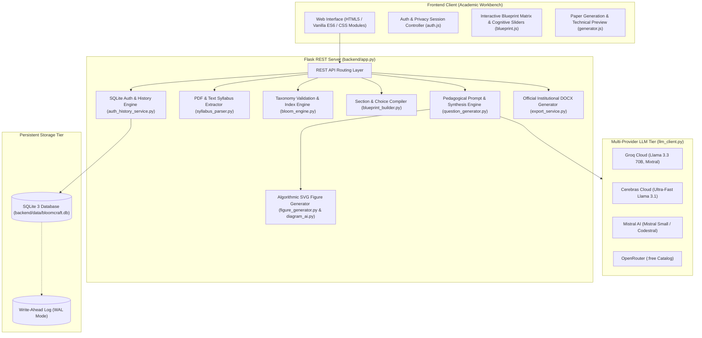

# System Architecture & Technical Design

BloomCraft AI is built as a modular, decoupled full-stack platform designed for high performance, zero cloud database costs, and zero required external graphic libraries.

---

## 🏗️ High-Level System Architecture

---

## 🧩 Architectural Components

### 1. Frontend Workbench (`frontend/`)
- Built purely with standard modern ES6 JavaScript, HTML5, and semantic CSS design tokens.
- No heavy frameworks (React/Vue/Angular) or Node build steps required.
- Three-stage guided wizard:
  1. **Stage 1 (Syllabus)**: Upload PDF syllabus or paste text with real-time module segmentation.
  2. **Stage 2 (Blueprint)**: Interactive matrix editor, internal choice toggles, and live Bloom cognitive slider calibration.
  3. **Stage 3 (Paper Studio)**: Real-time rendering of examination papers, inline AICTE verb badges, SVG diagrams, and export controls.

### 2. Backend REST Core (`backend/app.py`)
- Python Flask 3.0+ REST API server serving both web assets and JSON endpoints.
- Modular service architecture with clean separation of concerns:
  - `syllabus_parser.py`: Robust PDF parsing via `pdfplumber` with regex module boundaries.
  - `bloom_engine.py`: Cognitive index validator and level classification.
  - `blueprint_builder.py`: Slot allocation, choice management, and question constraint solving.
  - `question_generator.py`: Prompt synthesis and AICTE action verb enforcement.
  - `llm_client.py`: Multi-provider failover inference client.
  - `export_service.py`: `python-docx` document synthesis with institutional styling.

### 3. High-Performance SQLite Data Layer (`backend/data/bloomcraft.db`)
- Disk-backed ACID relational database with **Write-Ahead Logging (WAL)**.
- Replaces legacy monolithic JSON files to eliminate memory spikes and file lock contention.
- Indexed lookups for sessions (`tok_...`), usernames, and paper records (`pap_...`).
- History listings load only lightweight metadata (`paper_id, course_code, exam_title, total_marks, created_at`), completely bypassing heavy paper data and SVG payloads until an individual paper is opened.

### 4. Zero-Dependency Algorithmic Diagram Engine (`figure_generator.py`)
- Generates mathematically precise SVG vector figures dynamically without external graphic libraries.
- Produces:
  - Neural Network architectures & backpropagation computation graphs.
  - State transition diagrams & Markov chains.
  - Binary search trees & graph traversal paths.
  - Entity-Relationship (ER) schemas & relational tables.
  - ROC curves, bias-variance curves, and decision boundaries.

