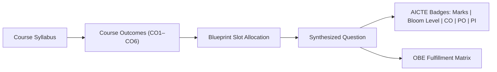

# Outcome-Based Education (OBE) & AICTE Compliance

BloomCraft AI is built in direct alignment with the **AICTE Examination Reform Policy** and NBA (National Board of Accreditation) Outcome-Based Education criteria.

---

## 🎯 Course Outcomes (COs) to Program Outcomes (POs) Mapping

Every generated question is calibrated with three mandatory academic parameters:
1. **Course Outcome ($\text{CO}$)**: The specific course capability validated (CO1 through CO6).
2. **Program Outcome ($\text{PO}$)**: The graduate attribute addressed (PO1 to PO12, e.g., Engineering Knowledge, Problem Analysis, Design/Development).
3. **Performance Indicator ($\text{PI}$)**: Measurable sub-competency indicator (e.g., `1.3.1`, `3.2.2`).

---

## 📋 Course Outcomes Coverage Matrix Example

During paper generation, the engine synthesizes an official OBE fulfillment matrix exported directly into Microsoft Word (`.docx`) tables:

| Question # | Marks | Bloom Tier | AICTE Action Verb | Mapped CO | Course Outcome Description | Program Outcome |
| :---: | :---: | :---: | :--- | :---: | :--- | :---: |
| **Q1** | 5 | L1 (Remember) | **Define** | CO1 | Formulate state-space search and problem formulations | PO1 |
| **Q2** | 5 | L2 (Understand) | **Explain** | CO2 | Understand supervised learning algorithms and metrics | PO2 |
| **Q3** | 5 | L3 (Apply) | **Apply** | CO3 | Apply unsupervised clustering algorithms to high-dimensional datasets | PO3 |
| **Q4** | 5 | L2 (Understand) | **Describe** | CO4 | Explain neural network architectures and activation dynamics | PO2 |
| **Q5** | 5 | L3 (Apply) | **Calculate** | CO2 | Compute OLS regression parameters and gradient descent updates | PO1 |
| **Q6 (OR)**| 10 | L4 (Analyze) | **Analyze** | CO3 | Analyze PCA covariance matrices and eigenvalue variance ratios | PO4 |
| **Q7** | 5 | L4 (Analyze) | **Compare** | CO4 | Differentiate MLP regularization effects under L1 and L2 penalties | PO3 |
| **Q8 (OR)**| 10 | L5 (Evaluate) | **Justify** | CO5 | Evaluate DQN agent convergence under varying reward matrices | PO5 |
| **Q9 (OR)**| 15 | L6 (Create) | **Design** | CO1 | Design a hybrid A* search algorithm for dynamic weighted graphs | PO3 |

---

## 🏛️ AICTE Examination Reform Guidelines Checklist

- [x] **No Question Without Bloom's Tag**: Every item displays explicit Bloom level (L1–L6).
- [x] **Action Verb Strictness**: Question text strictly starts with or is led by authorized AICTE taxonomy action verbs (*Define, Explain, Calculate, Analyze, Justify, Design*).
- [x] **Internal Choice Parity**: When internal choices (`OR`) are provided, both alternative questions belong to the **same Course Outcome ($\text{CO}$)** and identical marks weightage.
- [x] **Balanced Cognitive Rigor**: Elimination of papers dominated exclusively by low-level rote memorization questions ($>60\%$ higher-order thinking skills L3–L6 in autonomous modes).

