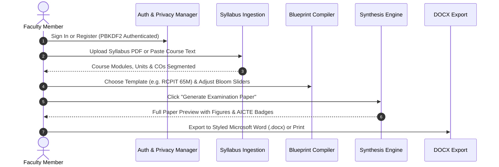

# Faculty User Guide & Workflow Walkthrough

A practical walkthrough for university faculty members creating balanced, AICTE-compliant examination papers.

---

## 🚀 The 4-Stage Faculty Workflow

---

## Step 1: Faculty Authentication & Session Gate
1. Navigate to the web studio: `http://127.0.0.1:5000`.
2. Faculty members must authenticate or register an account. Passwords are saved with **PBKDF2-SHA256 (120,000 hashing rounds)**.
3. Once logged in, your workspace is private: question papers generated in your account can only be accessed or deleted by your credentials.

---

## Step 2: Syllabus Ingestion & Processing
1. In **Stage 1 (Syllabus)**, choose one of two options:
   - **Upload Syllabus PDF**: Select any official university syllabus PDF file. The engine uses `pdfplumber` to extract text and segment modules.
   - **Paste Curriculum Text**: Paste your syllabus directly into the text editor.
   - **Quick Demo**: Click on any preloaded sample syllabus (e.g. *Artificial Intelligence & Machine Learning*, *Database Management Systems*).
2. The system automatically segments modules into:
   - Unit numbers and descriptive unit titles.
   - Fine-grained technical topics list.
   - Course Outcomes (CO1 through CO6).

---

## Step 3: Blueprint & Cognitive Distribution Calibration
1. Navigate to **Stage 2 (Blueprint Matrix)**.
2. Select an institutional template from the dropdown:
   - **R. C. Patel Institute of Technology (RCPIT) - 65 Marks (02:00 Hrs)**
   - **R. C. Patel Institute of Technology (RCPIT) - 60 Marks (02:00 Hrs)**
   - **SVKM D. J. Sanghvi College of Engineering (DJSCE) - 60 Marks**
   - **Semester End Examination (100 Marks)**
   - **Mid-Semester Examination (50 Marks)**
3. Adjust the **Bloom Cognitive Sliders**:
   - Sliders dynamically balance across L1 through L6.
   - The live **Cognitive Index ($\text{CI}$)** indicator shows the academic tier in real-time.
4. Customize sections, question counts, marks per question, and internal choices (`OR`).

---

## Step 4: Paper Synthesis & Review
1. Click **"Generate Examination Paper"**.
2. The pedagogical prompt engine synthesizes high-quality technical questions mapped to the blueprint slots:
   - Every question starts with authorized AICTE action verbs.
   - Questions requiring diagrams feature dynamically rendered SVG technical figures (circuit diagrams, decision trees, neural network layer plots, confusion matrices).
3. If you want to modify a specific question:
   - Click the **Regenerate** button on that question slot to synthesize an alternative question matching the same Bloom tier and Course Outcome.
   - Or click **Edit** to adjust wording manually.

---

## Step 5: Exporting Institutional Question Papers
1. Click **"Export Word (.docx)"** in the top action bar.
2. The backend synthesizes a ready-to-print Microsoft Word document containing:
   - Official institutional header and autonomous college profile.
   - Course code, course title, session, exam title, duration, and maximum marks.
   - Clean tabular instructions.
   - Structured questions with bold marks annotations and diagrams.
   - Dedicated **Course Outcomes (CO) Fulfillment Matrix** table.
3. Click **"Print / Save PDF"** to preview print layout using print-specific CSS rules.

---

## Step 6: Past Papers Archive
1. Click **"Past Papers"** in the top navigation bar.
2. Review previously synthesized question papers stored securely in your private SQLite archive.
3. Click on any past paper to re-load it into the studio or download its DOCX export anytime.
